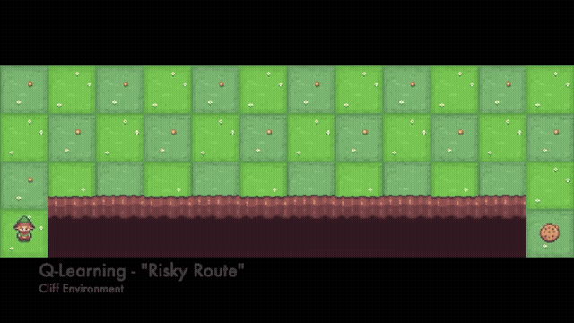

# Q-learning vs SARSA

Two tabular reinforcement-learning experiments exploring how the update rule changes learned behavior. **Taxi** compares the algorithms on a pickup-and-drop-off task; **CliffWalking** puts exploration next to a large penalty.

**Python · Gymnasium · NumPy · Matplotlib**



[Demonstrations ↗](https://aravsportfolio.com/?project=q-learning-vs-sarsa)

## The distinction

| Algorithm | Update target | Behavior under exploration |
| :--- | :--- | :--- |
| Q-learning | `r + γ max Q(s′, a′)` | Learns toward the best next action. |
| SARSA | `r + γ Q(s′, a′)` | Learns from the next action actually sampled. |

In CliffWalking, exploratory moves can turn a short route into an expensive one. SARSA’s update includes those exploratory choices, which can favor routes with a larger margin from the cliff. This is an experiment to inspect, rather than a universal safety claim.

## Run

```bash
python -m pip install "gymnasium[toy-text]" numpy matplotlib moviepy
python qlearn_SARSA_comparison.py
python qlearn_SARSA_difference.py
```

| Script | Default experiment | Outputs |
| :--- | :--- | :--- |
| [`qlearn_SARSA_comparison.py`](qlearn_SARSA_comparison.py) | `Taxi-v3`, 50,000 episodes per algorithm | `learning_curve_taxi.png`, `videos/` |
| [`qlearn_SARSA_difference.py`](qlearn_SARSA_difference.py) | `CliffWalking-v1`, 100,000 episodes per algorithm | `cliff_curves.png`, `videos_cliff/` |

Both scripts train with epsilon-greedy exploration. The default recordings use greedy policies; the CliffWalking `record_video` function also accepts an `epsilon` argument for exploratory rollouts.

## Interpreting the output

Read training returns alongside the CliffWalking fall rates printed to the terminal. The GIF is an extract from the portfolio demonstration. The checked-in scripts do not add a separate execution-noise wrapper or save a multi-seed benchmark. Environment resets are seeded, but action-space sampling is not explicitly seeded, so runs may differ.
